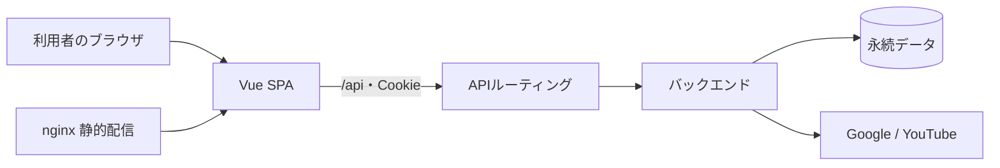

# NASB1995 フロントエンド 総合設計書

## 1. 文書の目的と対象

本書は、アジャイル開発で段階的に構築・変更されてきたシステムの現行実装を、要件定義・基本設計・詳細設計の観点でまとめたものである。2026年11月16日時点のこのリポジトリのソース、テストおよび README を根拠とする。過去の意思決定、開発プロセスの実績、将来の計画を保証するものではない。以後の変更では、本書も実装と併せて更新する。

対象は Vue によるフロントエンドと、その画面から見た外部インターフェースに限定する。バックエンドとデータベースの設計はバックエンド側の `doc` フォルダの設計書を参照する。インフラ、YouTube・Google 側の内部設計も対象外とし、フロントエンドから確認できる振る舞いのみ記載する。実装上の仕様と業務上の意図が一致するかは、関係者による確認を要する。

## 2. 要件定義

### 2.1 目的と利用者

賛美歌の曲名・歌詞・楽譜を閲覧、検索できるようにし、管理利用者が賛美歌、聖書の章節および本人の情報を管理できるようにする。また、YouTube と連携して賛美歌のプレイリストを作成できるようにする。

| 利用者                   | 主な利用                                                         |
| ------------------------ | ---------------------------------------------------------------- |
| 未ログインの閲覧者       | ホームで賛美歌を検索・閲覧し、楽譜を取得する                     |
| ログイン済みの管理利用者 | 賛美歌・楽譜・聖書の節・本人情報を管理し、YouTube 連携を利用する |

管理画面とログイン画面は幅768px以上を想定する。画面幅による制限は操作上の制限であり、認可の代替ではない。権限の最終的な検証はバックエンドに依存する。

### 2.2 機能要件

| ID  | 要件           | 現行の実現方法                                                                                                       |
| --- | -------------- | -------------------------------------------------------------------------------------------------------------------- |
| F01 | 賛美歌の閲覧   | 一覧から曲を選び、曲名、歌詞、楽譜の調などを表示する。検索語に一致する歌詞を強調する                                 |
| F02 | 賛美歌の検索   | 曲名・歌詞等のキーワードで検索し、一致度と歌詞の抜粋を表示する。入力内容に応じて画面内検索とサーバー検索を使い分ける |
| F03 | 楽譜の取得     | 曲と調を指定して楽譜をダウンロードする                                                                               |
| F04 | 認証           | ログイン・ログアウトし、管理画面への遷移時にログイン状態を確認する                                                   |
| F05 | 賛美歌の管理   | 一覧の検索・ページ送り、追加・編集・削除を行う。削除前に可否を確認し、利用者に確認する                               |
| F06 | 楽譜の登録     | 曲に対してファイル、調、オリジナル指定を送信し、既存楽譜との衝突時には上書きを確認する                               |
| F07 | ランダム選択   | キーワードを指定して賛美歌をランダムに選択し、結果を表示する                                                         |
| F08 | プレイリスト   | 一覧の検索条件またはランダム選択結果から YouTube プレイリストを作成し、進捗と結果を示す                              |
| F09 | 聖書の章節入力 | 書・章・節と英語・日本語本文を入力する。登録済みの節は読み込み、上書き前に確認する                                   |
| F10 | 本人情報と連携 | ログイン中の本人のアカウント情報を更新し、YouTube 連携の開始・解除を行う                                             |
| F11 | 編集内容の保護 | 対象の編集画面で未保存の変更があるとき、画面遷移やブラウザ離脱を確認する                                             |
| F12 | エラー通知     | 入力不備、通信失敗、セッション失効、操作結果等を画面に通知する                                                       |

### 2.3 非機能要件・実装上の方針

- **対応画面**: ホームはPC・モバイルに対応し、幅768pxを境に表示を切り替える。ログイン・管理画面はPC幅で使用する。
- **安全性**: Cookie を伴う通信、CSRF トークン、認証状態の確認を使用する。入力チェックや画面の遷移制限だけでサーバー側の認証・認可を代替しない。
- **操作性**: 入力エラー、処理中、確認、失敗、完了を画面に示す。検索欄では Enter による操作にも対応する。
- **応答性**: データ取得のキャッシュ、検索索引、ページ分割・追加読み込みを利用する。具体的な応答時間や同時利用数の目標は未確認。
- **保守性**: 画面、共通部品、通信、状態、業務ロジックを分け、型検査・静的解析・自動テストを用いる。
- **配信**: ビルドした静的ファイルを nginx で配信する。運用監視、可用性、バックアップ、対応ブラウザの正式な目標は未確認。

## 3. 基本設計

### 3.1 システム構成と責務

ブラウザ内の SPA が画面表示、入力検証、画面状態、検索の一部を担当する。バックエンドは API、認証、データの永続化および外部連携の窓口である。図のバックエンド以降はフロントエンドから見た論理構成であり、実際の配置や内部構成を保証しない。

開発時は Vite が `/api` を除去して `http://localhost:8277` に転送する。本番では前段が `/api` をバックエンドへ振り分ける想定であり、このリポジトリの nginx 設定自体には API 転送設定はない。nginx はポート3000で静的ファイルを提供し、未一致パスを `index.html` にフォールバックする。

### 3.2 画面と遷移

| パス                 | 画面                   | 利用条件・主な操作                                             |
| -------------------- | ---------------------- | -------------------------------------------------------------- |
| `/`                  | 入口                   | `/home` へ転送                                                 |
| `/home`              | ホーム                 | 公開。検索、一覧、詳細、歌詞、楽譜取得                         |
| `/login`             | ログイン               | PC幅。認証後メインメニューへ                                   |
| `/mainmenu`          | メインメニュー         | 認証・PC幅。管理機能への入口                                   |
| `/hymns`             | 賛美歌情報メンテナンス | 認証・PC幅。検索、追加、編集、削除、楽譜登録、プレイリスト作成 |
| `/hymns/random-five` | 賛美歌ランダム選択     | 認証・PC幅。検索・再選択、プレイリスト作成                     |
| `/books/add`         | 聖書章節入力           | 認証・PC幅。書・章・節と本文の登録・更新                       |
| `/personal`          | ユーザー情報           | 認証・PC幅。本人情報の更新と YouTube 連携                      |
| `/error`             | エラー                 | 認証・PC幅。エラー表示                                         |
| その他               | 404                    | 存在しないパスを表示                                           |

ホームはPCでは一覧と選択曲の詳細を左右に表示し、一覧は1ページ10曲とする。モバイルでは10曲ずつ追加読み込みし、選択した曲の詳細をシートで表示する。管理画面は共通レイアウト、サイドバー、ヘッダーを使用する。

### 3.3 データの概念

| データ           | 主な項目・用途                                                                                               |
| ---------------- | ------------------------------------------------------------------------------------------------------------ |
| 賛美歌           | 文字列ID、日本語名、韓国語名、リンク、歌詞、クラシック区分、更新日時・更新者。一覧には一致度・歌詞抜粋もある |
| 楽譜             | 賛美歌、調、ファイル、オリジナル指定。曲と調を指定して取得する                                               |
| 聖書の節         | 書、章、節番号、英語本文、日本語本文。本文に赤字表記を含められる                                             |
| 利用者           | ID、ログインアカウント、ユーザー名、パスワード、生年月日、メールアドレス                                     |
| プレイリスト処理 | プレイリストID、URL、状態、対象件数、追加済み件数、メッセージ                                                |

上記は画面・API上の論理項目であり、物理テーブル定義ではない。賛美歌の19桁の Snowflake ID は JavaScript の数値精度を避けるため文字列で扱う。

## 4. 詳細設計

### 4.1 構成要素

| 領域                       | 責務                                                               |
| -------------------------- | ------------------------------------------------------------------ |
| `src/views`・`src/layouts` | 画面、画面単位の状態、管理画面の共通レイアウト                     |
| `src/components`           | フォーム、楽譜、ホーム詳細、通知等の再利用部品                     |
| `src/router`               | ルート定義、画面幅・未保存・認証のガード                           |
| `src/api`                  | Axios 共通設定、賛美歌APIとデータ型                                |
| `src/stores`               | 認証、CSRF、通知・確認、未保存状態を Pinia で管理                  |
| `src/composables`          | 画面幅判定、遅延反映、未保存確認、セッション確認、プレイリスト作成 |
| `src/lib`                  | 検索、歌詞、楽譜、調号、赤字編集、ダウンロード等の処理             |
| `src/plugins`              | Pinia、ルーター、Vuetify、Vue Query、フォント等の登録              |

Vue 3、TypeScript、Vue Router、Pinia、Vuetify、TanStack Vue Query、Axios、Vite を使用する。依存バージョンは `package.json` とロックファイルを正とする。

### 4.2 認証・通信・画面遷移

1. Axios は `/api` を基点とし、認証情報を含める。GET・HEAD・OPTIONS 以外には取得済み CSRF トークンを指定ヘッダーで付与する。
2. 403 応答時はトークンを再取得し、当該リクエストを最大1回再送する。すべての403が CSRF 原因とは限らず、再送後の失敗は呼び出し元に返す。
3. ルーターガードは画面幅、未保存、認証の順に実行する。管理画面への初回遷移時は必要に応じ `/common/me` を呼び、未認証または確認失敗ならホームへ戻す。
4. ログインはユーザー名・パスワードを送信後、本人情報と CSRF トークンを再取得する。ログアウト後も CSRF トークンを取得する。
5. 管理画面の表示中は、タブが表示されている間、15秒ごとにセッションを確認する。非表示中は停止し、再表示時に直ちに確認する。
6. 別端末ログインによる失効またはログイン中の期限切れを検出した場合、メッセージを一時保存してホームへ全画面遷移し、クライアント側状態を初期化する。強制遷移では未保存警告を抑止する。

認証情報の `roles` は現行の `/common/me` 応答から設定されず空配列となる。画面側のロール判定を権限制御として利用するにはサーバー契約の確認が必要である。

### 4.3 検索と表示

- ホームで空文字、ハングルを含む語、先頭が `*`・`★`・`#` の語、または `&` を含む語はサーバー検索に送る。検索語は NFC に正規化する。
- その他の日本語・英語等は検索索引を取得し、画面内で日本語名・英語名と日本語・英語の歌詞を照合する。NFKC、英字小文字化、カタカナのひらがな化、記号・空白の除去を行い、部分一致や文字2-gramの近さを用いる。韓国語歌詞は画面内索引の対象外。
- 画面内検索は一致曲を先に並べ、非一致曲も後方に残す。一致がない場合は通常順に全曲を表示し、その旨を通知する。索引の取得に失敗した場合はサーバー検索に切り替える。
- 一覧の一致度は `CADMIUM`、`BURGUNDY`、`NAPLES`、`SNOWY` を扱う。検索結果に歌詞の抜粋があれば表示し、詳細の歌詞では検索語の一致箇所を強調する。
- 賛美歌の追加・編集・削除後は関連する賛美歌のキャッシュを無効化する。歌詞編集後は当該歌詞のキャッシュも無効化する。検索索引と歌詞のキャッシュ期間は5分、通常のクエリは30秒を基本とする。

### 4.4 賛美歌・楽譜の管理

- 賛美歌フォームは日本語名、韓国語名、リンク、歌詞を必須とし、クラシック区分を指定する。名称の重複確認を API に問い合わせる。韓国語名は NFC に正規化する。
- 編集時は詳細を取得し、取得時の `updatedTime` とログイン利用者IDを更新要求に含める。競合判定の実際の契約はバックエンド側の確認を要する。詳細の取得に失敗した場合は空のまま更新できないようフォームを閉じる。
- 追加後は応答ヘッダー `X-Page-Num` を参照し、検索を解除して追加先ページに移動する。削除は事前チェックと利用者確認の後に実行する。
- 楽譜登録はファイルと調を必須とし、30 MiBを超えるファイルは画面側で拒否する。調は A、Bb、B、C、Db、D、Eb、E、F、Gb、G、Ab の12長調。`score`、`chord`、`isOriginal`、`overwrite` を multipart で送る。409では上書きを確認し、承諾時に再送する。
- フォームで編集した内容がある場合、閉じる操作や画面遷移時に破棄を確認する。楽譜のアップロード中はモーダルを閉じられない。

### 4.5 聖書の章節と本人情報

- 書と章の一覧を取得し、章と数字の節番号が確定してから300ms後に既存節を照会する。英語本文、日本語本文、節番号は保存時に必須とする。既存節または照会失敗時は上書きの可能性を確認してから保存する。
- 本文の赤字は `{{...}}` の記法とエディタ表示の間で変換する。書・章の一覧は長期間キャッシュし、節内容の照会結果は保持しない。
- 本人情報の編集対象IDは URL ではなく認証状態から取得する。ログインアカウント、ユーザー名、パスワード、生年月日、メールアドレスを必須とし、ログインアカウントは重複確認する。パスワードのマスク値の扱いはサーバーとの契約に依存する。
- YouTube 連携開始時はバックエンドの認可URLへ画面遷移する。戻り先の `youtube` クエリ値で結果を通知し、URLから除去する。連携済みの状態で切り替えをOFFにすると解除を要求する。

### 4.6 プレイリスト

一覧からは検索キーワード、ランダム選択からは表示結果の曲ID配列を送信する。一覧ではページをまたぐ対象曲の収集をバックエンドに委ねる。作成要求後、`running` の間は1.5秒ごとに状態を取得し、追加済み件数を表示する。`done` では YouTube へ移動するか確認し、`failed` では理由を表示する。10分経過時は待機を終了するが、サーバー処理は継続し得る。409の未連携・再認証時は本人情報画面への移動を案内する。

### 4.7 API インターフェース一覧

パスは `/api` を除いたフロントエンド上の指定。認可条件、全応答形式、エラーコードの完全な定義はバックエンドの仕様を参照・確認する。

| メソッド・パス                                                                           | 用途・主な指定                                                                      |
| ---------------------------------------------------------------------------------------- | ----------------------------------------------------------------------------------- |
| GET `/common/csrf`、`/common/me`                                                         | CSRF トークン、本人情報の取得                                                       |
| POST `/login`、`/logout`                                                                 | ログイン、ログアウト                                                                |
| GET `/hymns`                                                                             | `pageNum`、`pageSize`、`keyword` で一覧・検索。`records`、`totalRecords` を受け取る |
| GET `/hymns/search-index`                                                                | 画面内検索の索引取得                                                                |
| GET `/hymns/{id}`、`/hymns/{id}/lyric`                                                   | 編集用詳細、歌詞の取得                                                              |
| POST `/hymns`、PUT・DELETE `/hymns/{id}`                                                 | 賛美歌の追加、更新、削除                                                            |
| GET `/hymns/duplicate-check-jp`、`/hymns/duplicate-check-kr`、`/hymns/{id}/delete-check` | 重複および削除可否の確認                                                            |
| GET・POST `/hymns/{id}/score`                                                            | 楽譜・調情報の取得、楽譜登録                                                        |
| GET `/hymns/random`、`/common/search`                                                    | キーワードによるランダム選択                                                        |
| GET `/books`、`/books/{bookId}/chapters`、`/books/{chapterId}/verse`                     | 書・章・既存節を取得。節には `verseNo` を指定                                       |
| POST `/books`                                                                            | `chapterId`、節番号 `id`、`textEn`、`textJp` を保存                                 |
| GET・PUT `/students/{id}`、GET `/students/duplicate-check`                               | 本人情報の取得・更新、アカウント重複確認                                            |
| GET `/youtube/status`、`/youtube/authorize-url`、POST `/youtube/unlink`                  | 連携状態確認、連携開始、解除                                                        |
| POST `/youtube/create-playlist`、GET `/youtube/playlist-status`                          | 作成開始、`playlistId` による進捗確認                                               |

## 5. テスト・ビルド・運用

| コマンド         | 目的                                                |
| ---------------- | --------------------------------------------------- |
| `pnpm install`   | ロックファイルに従う依存関係の導入                  |
| `pnpm dev`       | 開発サーバーの起動                                  |
| `pnpm build`     | 型検査と本番向けビルド                              |
| `pnpm test`      | Vitest によるユニット・DOMテスト                    |
| `pnpm lint`      | ESLint による静的解析                               |
| `pnpm e2e`       | Playwright による画面操作テスト                     |
| `docker build .` | ビルド済みファイルを nginx で配信するイメージの作成 |

テストには、認証ガード、CSRF再送、セッション失効、検索、未保存確認、プレイリスト、ログイン、ホーム、賛美歌操作等のケースがある。E2E は API をモックするため、実バックエンドや Google・YouTube との接続を保証しない。実環境の結合試験、性能・セキュリティ試験、受入基準や実施結果は別途確認する。

## 6. 未確定事項・確認事項

1. 利用者区分、権限、認可ルール、管理画面をPC幅に限定する業務上の理由は何か。`/common/me` のロール未返却は意図した仕様か。
2. 可用性・性能・対応ブラウザ・アクセシビリティ・監視・障害復旧・バックアップの正式な目標は何か。
3. 賛美歌・歌詞・楽譜・聖書本文の公開範囲、利用権限、データ保持・削除方針は何か。
4. APIの完全な契約、入力制約、楽観ロック時の応答、パスワードのマスク値、YouTube側制約の正本は何か。
5. 開発の実際の進め方、リリース履歴、受入基準、および実施済みの結合・受入試験の記録はどこにあるか。

これらは現行コードだけからは確定できないため、確認後に要件と設計へ反映する。
