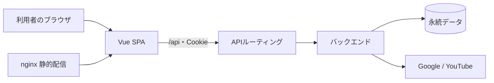
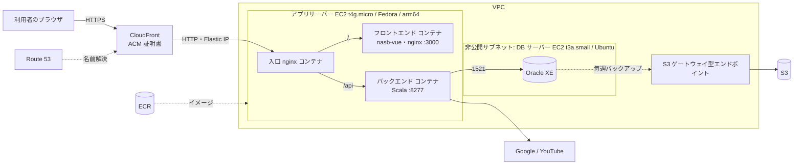

# NASB1995 フロントエンド 総合設計書

## 1. 文書の目的と対象

本書は、アジャイル開発で段階的に構築・変更されてきたシステムの現行実装を、要件定義・基本設計・詳細設計の観点でまとめたものである。2026年11月17日時点のこのリポジトリのソース、テストおよび README を根拠とする。インフラ構成（6章）は、バックエンドの手順書・ビルドスクリプトと関係者からの聞き取りを根拠とする。過去の意思決定、開発プロセスの実績、将来の計画を保証するものではない。以後の変更では、本書も実装と併せて更新する。

対象は Vue によるフロントエンド、その画面から見た外部インターフェース、およびシステムを動かす AWS のインフラ構成とする。バックエンド・データベース・YouTube・Google 側の内部設計は、バックエンド側の `docs` フォルダの設計書を参照する。インフラは構成と役割のみを記載し、アカウントID・インスタンスID・リソース名などの識別子は記載しない。実装上の仕様と業務上の意図が一致するかは、関係者による確認を要する。画面の配色・大きさ・部品の見た目の決まりは [UIGuidelines.md](UIGuidelines.md) にまとめる。

## 2. 要件定義

### 2.1 目的と利用者

賛美歌の曲名・歌詞・楽譜を閲覧、検索できるようにし、管理利用者が賛美歌、聖書の章節および本人の情報を管理できるようにする。また、YouTube と連携して賛美歌のプレイリストを作成できるようにする。

| 利用者                   | 主な利用                                                         |
| ------------------------ | ---------------------------------------------------------------- |
| 未ログインの閲覧者       | ホームで賛美歌を検索・閲覧し、楽譜を取得する                     |
| ログイン済みの管理利用者 | 賛美歌・楽譜・聖書の節・本人情報を管理し、YouTube 連携を利用する |

管理画面とログイン画面は幅768px以上で利用する。モバイル（幅768px未満）ではログインできない仕様とし、ログインボタンも表示しない。画面幅による制限は操作上の制限であり、認可の代替ではない。権限の最終的な検証はバックエンドに依存する。

### 2.2 機能要件

| ID  | 要件           | 現行の実現方法                                                                                                                 |
| --- | -------------- | ------------------------------------------------------------------------------------------------------------------------------ |
| F01 | 賛美歌の閲覧   | 一覧から曲を選び、曲名、歌詞、楽譜の調などを表示する。検索語に一致する歌詞を強調する                                           |
| F02 | 賛美歌の検索   | 曲名・歌詞等のキーワードで検索し、一致度の高い順に並べて一致度を表示する。入力内容に応じて画面内検索とサーバー検索を使い分ける |
| F03 | 楽譜の取得     | 登録済みの調から1つを選び、その調の楽譜をダウンロードする                                                                      |
| F04 | 認証           | ログイン・ログアウトし、管理画面への遷移時にログイン状態を確認する                                                             |
| F05 | 賛美歌の管理   | 一覧の検索・ページ送り、追加・編集・削除を行う。削除前に可否を確認し、利用者に確認する                                         |
| F06 | 楽譜の登録     | 曲に対してファイル、調、オリジナル指定を送信し、既存楽譜との衝突時には上書きを確認する                                         |
| F07 | ランダム選択   | キーワードを指定して賛美歌をランダムに選択し、結果を表示する                                                                   |
| F08 | プレイリスト   | 一覧の検索条件またはランダム選択結果から YouTube プレイリストを作成し、進捗と結果を示す                                        |
| F09 | 聖書の章節入力 | 書・章・節と英語・日本語本文を入力する。登録済みの節は読み込み、上書き前に確認する                                             |
| F10 | 本人情報と連携 | ログイン中の本人のアカウント情報を更新し、YouTube 連携の開始・解除を行う                                                       |
| F11 | 編集内容の保護 | 対象の編集画面で未保存の変更があるとき、画面遷移やブラウザ離脱を確認する                                                       |
| F12 | エラー通知     | 入力不備、通信失敗、セッション失効、操作結果等を画面に通知する                                                                 |

### 2.3 非機能要件・実装上の方針

- **対応画面**: ホームはPC・モバイルに対応し、幅768pxを境に表示を切り替える。ログイン・管理画面はPC幅で使用する。
- **安全性**: Cookie を伴う通信、CSRF トークン、認証状態の確認を使用する。入力チェックや画面の遷移制限だけでサーバー側の認証・認可を代替しない。
- **操作性**: 入力エラー、処理中、確認、失敗、完了を画面に示す。検索欄では Enter による操作にも対応する。
- **性能**: API の各リクエストの応答時間（レイテンシー）は200ms以内を目標とする。画面側ではデータ取得のキャッシュ、検索索引、ページ分割・追加読み込みを利用して通信を減らす。
- **保守性**: 画面、共通部品、通信、状態、業務ロジックを分け、型検査・静的解析・自動テストを用いる。
- **対応ブラウザ**: Chrome・Edge 111以降、Firefox 114以降、Safari・iOS Safari 16.4以降とする。現行のビルド（Vite の既定の出力対象）がこれらのブラウザを前提とした JavaScript・CSS を出力するためで、これより古いブラウザでは動作しない。
- **配信**: ビルドした静的ファイルを nginx のコンテナで配信し、利用者へは CloudFront を通して届ける（6章）。DB は毎週バックアップする。

## 3. 基本設計

### 3.1 システム構成と責務

ブラウザ内の SPA が画面表示、入力検証、画面状態、検索の一部を担当する。バックエンドは API、認証、データの永続化および外部連携の窓口である。上の図は論理構成であり、AWS 上の実際の配置は6章に記載する。

開発時は Vite が `/api` を除去して `http://localhost:8277` に転送する。本番では入口の nginx コンテナが `/api` をバックエンドへ振り分ける（6.2）。このリポジトリの nginx 設定（フロントエンドのコンテナ用）自体には API 転送設定はなく、ポート3000で静的ファイルを提供し、未一致パスを `index.html` にフォールバックする。

### 3.2 画面と遷移

| パス                 | 画面                   | 利用条件・主な操作                                             |
| -------------------- | ---------------------- | -------------------------------------------------------------- |
| `/`                  | 入口                   | `/home` へ転送                                                 |
| `/home`              | ホーム                 | 公開。検索、一覧、詳細、歌詞、楽譜取得                         |
| `/login`             | ログイン               | PC幅。認証後メインメニューへ                                   |
| `/mainmenu`          | メインメニュー         | 認証・PC幅。管理機能への入口                                   |
| `/hymns`             | 賛美歌情報メンテナンス | 認証・PC幅。検索、追加、編集、削除、楽譜登録、プレイリスト作成 |
| `/hymns/random-five` | 賛美歌ランダム選択     | 認証・PC幅。検索・再選択、プレイリスト作成                     |
| `/books/add`         | 聖書章節入力           | 認証・PC幅。書・章・節と本文の登録・更新                       |
| `/personal`          | ユーザー情報           | 認証・PC幅。本人情報の更新と YouTube 連携                      |
| `/error`             | エラー                 | 認証・PC幅。エラー表示                                         |
| その他               | 404                    | 存在しないパスを表示                                           |

ホームはPCでは一覧と選択曲の詳細を左右に表示し、一覧は1ページ10曲とする。モバイルでは一覧を下までスクロールすると10曲ずつ追加読み込みし、選択した曲の詳細を画面下から出るシートで表示する。シートは左右のスワイプで前後の曲へ移り、取っ手を下へスワイプ・背景を押す・閉じるボタンで閉じる。詳細では登録済みの調から1つを選ぶと五線譜の調号が変わり、五線譜を押すとその調の楽譜をダウンロードする。モバイルのホームにはログインボタンを置かない。管理画面は共通レイアウト、サイドバー、ヘッダーを使用する。

### 3.3 データの概念

| データ           | 主な項目・用途                                                                                                                                                                                    |
| ---------------- | ------------------------------------------------------------------------------------------------------------------------------------------------------------------------------------------------- |
| 賛美歌           | 文字列ID、日本語名、韓国語名、英語名（検索索引のみ）、リンク、歌詞、クラシック区分、更新日時・更新者。一覧には一致度もある。検索時にサーバーが返す歌詞の抜粋（`snippet`）は現行画面では表示しない |
| 楽譜             | 賛美歌、調、ファイル、オリジナル指定。曲と調を指定して取得する                                                                                                                                    |
| 聖書の節         | 書、章、節番号、英語本文、日本語本文。本文に赤字表記を含められる                                                                                                                                  |
| 利用者           | ID、ログインアカウント、ユーザー名、パスワード、生年月日、メールアドレス                                                                                                                          |
| プレイリスト処理 | プレイリストID、URL、状態、対象件数、追加済み件数、メッセージ                                                                                                                                     |

上記は画面・API上の論理項目であり、物理テーブル定義ではない。賛美歌の19桁の Snowflake ID は JavaScript の数値精度を避けるため文字列で扱う。

## 4. 詳細設計

### 4.1 構成要素

| 領域                       | 責務                                                                                                                                                                                                                                |
| -------------------------- | ----------------------------------------------------------------------------------------------------------------------------------------------------------------------------------------------------------------------------------- |
| `src/main.ts`              | アプリを作り、`src/plugins/index.ts` の `registerPlugins` でプラグインをまとめて登録する（create-vuetify のひな形と同じ形）                                                                                                         |
| `src/views`・`src/layouts` | 画面、画面単位の状態、管理画面の共通レイアウト                                                                                                                                                                                      |
| `src/components`           | フォーム、楽譜、ホーム詳細、通知等の再利用部品                                                                                                                                                                                      |
| `src/router`               | ルート定義、画面幅・未保存・認証のガード                                                                                                                                                                                            |
| `src/api`                  | Axios 共通設定、賛美歌APIとデータ型                                                                                                                                                                                                 |
| `src/stores`               | 認証（auth）、CSRF（csrf）、通知・確認（feedback）、未保存状態（unsavedGuard）を Pinia で管理                                                                                                                                       |
| `src/composables`          | 画面幅判定（useIsMobile）、遅延反映（useDebouncedValue）、未保存確認（useUnsavedChanges）、セッション確認（useSessionCheck）、プレイリスト作成（usePlaylistCreation）                                                               |
| `src/lib`                  | 検索、歌詞、楽譜、調号、赤字編集、ダウンロード等の処理。nasb-next から移植し、テストを付ける                                                                                                                                        |
| `src/plugins`              | Pinia、ルーター、Vuetify、Vue Query、フォント等の登録                                                                                                                                                                               |
| `src/styles`               | 要素の既定の余白のリセット・書体のクラス・ロゴの効果（`main.css`）、画面固有のクラス（`app.css`。nasb-next の globals.css から移したガラスカード・赤字エディタ等）、Vuetify の Sass 変数（`settings.scss`。本文・見出しのフォント） |

`src/plugins` の各ファイルは次のとおり。

- `vuetify.ts`: テーマ色（値は [UIGuidelines.md](UIGuidelines.md) の 3.1）、日本語の文言、モバイル判定の境目（768px）。ライトテーマ固定。
- `icons.ts`: `@mdi/js` の SVG のうち使うものだけを登録する。テンプレートでは `mdi-xxx` の名前で書き、新しいアイコンは `ICONS` に1行足す。
- `fonts.ts`: Fontsource で Noto Sans JP / Noto Serif JP / Noto Serif KR / Niconne を自前配信する。
- `queryClient.ts`: TanStack Vue Query の共通設定。
- `index.ts`: 上記と Pinia・ルーターをまとめて登録する（Pinia を最初に登録する。ルーターのガードや Axios のインターセプターがストアを使うため）。

Vue 3、TypeScript、Vue Router、Pinia、Vuetify、TanStack Vue Query、Axios、Vite を使用する。依存バージョンは `package.json` とロックファイルを正とする。

### 4.2 認証・通信・画面遷移

1. Axios は `/api` を基点とし、認証情報を含める。GET・HEAD・OPTIONS 以外には取得済み CSRF トークンを指定ヘッダーで付与する。
2. 403 応答時はトークンを再取得し、当該リクエストを最大1回再送する。すべての403が CSRF 原因とは限らず、再送後の失敗は呼び出し元に返す。
3. ルーターガードは画面幅、未保存、認証の順に実行する。`meta.pcOnly` の画面（ログイン・管理画面）を幅768px未満で開こうとした場合は「管理画面はPCからご利用ください。」と通知してホームへ置き換え遷移し、認証確認の通信も行わない。判定は遷移時のみで、表示後に幅が変わっても画面を閉じない。管理画面への初回遷移時は必要に応じ `/common/me` を呼び、未認証または確認失敗ならホームへ戻す。
4. ログインはユーザー名・パスワードを送信後、本人情報と CSRF トークンを再取得する。ログアウト後も CSRF トークンを取得する。
5. 管理画面の表示中は、タブが表示されている間、15秒ごとにセッションを確認する。非表示中は停止し、再表示時に直ちに確認する。
6. 別端末ログインによる失効またはログイン中の期限切れを検出した場合、メッセージを一時保存してホームへ全画面遷移し、クライアント側状態を初期化する。強制遷移では未保存警告を抑止する。

認証情報の `roles` は現行の `/common/me` 応答から設定されず空配列となる。画面側ではロールによる表示の出し分けを行わない。利用者区分・権限・認可ルールはバックエンドの設計書で定める。

### 4.3 検索と表示

- ホームで空文字、ハングルを含む語、先頭が `*`・`★`・`#` の語、または `&` を含む語はサーバー検索に送る。検索語は NFC に正規化する。
- その他の日本語・英語等は検索索引を取得し、画面内で日本語名・英語名と日本語・英語の歌詞を照合する。NFKC、英字小文字化、カタカナのひらがな化、記号・空白の除去を行い、部分一致や文字2-gramの近さを用いる。韓国語歌詞は画面内索引の対象外。
- 画面内検索は一致曲を先に並べ、非一致曲も後方に残す。一致がない場合は通常順に全曲を表示し、その旨を通知する。索引の取得に失敗した場合はサーバー検索に切り替える。
- 一覧の一致度は `lineNumber` の値で受け取り、検索時のみ次のように表示する。検索していないときは一致度の代わりに通し番号を表示する。詳細の歌詞では検索語の一致箇所を強調し、一致箇所の数を表示する。歌詞の抜粋（`snippet`）は表示しない。

  | 値              | 表示     |
  | --------------- | -------- |
  | `CADMIUM`       | よく一致 |
  | `BURGUNDY`      | 一致     |
  | `NAPLES`        | やや一致 |
  | `SNOWY`・その他 | 関連     |

- 賛美歌の追加・編集・削除後は関連する賛美歌のキャッシュを無効化する。歌詞編集後は当該歌詞のキャッシュも無効化する。キャッシュを新しいとみなす期間は、通常のクエリは30秒を基本とし、次を例外とする。

  | 対象                         | 期間                                             |
  | ---------------------------- | ------------------------------------------------ |
  | 検索索引・歌詞               | 5分                                              |
  | 楽譜の調の一覧               | 60秒                                             |
  | 編集フォームの詳細・本人情報 | 0（開くたびに取得）                              |
  | 書・章の一覧                 | 無期限                                           |
  | ランダム選択の結果           | 画面を開いている間は再取得しない（離れると破棄） |
  | 既存節の照会結果             | 保持しない                                       |

### 4.4 賛美歌・楽譜の管理

- 賛美歌フォームは日本語名、韓国語名、リンク、歌詞を必須とし、クラシック区分を指定する。名称の重複確認を API に問い合わせる。韓国語名は NFC に正規化する。
- 編集時は詳細を取得し、取得時の `updatedTime` とログイン利用者IDを更新要求に含める。競合判定の実際の契約はバックエンド側の確認を要する。詳細の取得に失敗した場合は空のまま更新できないようフォームを閉じる。
- 追加後は応答ヘッダー `X-Page-Num` を参照し、検索を解除して追加先ページに移動する。削除は事前チェックと利用者確認の後に実行する。
- 楽譜登録はファイルと調を必須とし、30 MiBを超えるファイルは画面側で拒否する。調は A、Bb、B、C、Db、D、Eb、E、F、Gb、G、Ab の12長調。調の一覧は取得時にこの順（Aから半音ずつ上がる順）に並べ替え、すべての画面で同じ順に表示する。`score`、`chord`、`isOriginal`、`overwrite` を multipart で送る。409では上書きを確認し、承諾時に再送する。
- フォームで編集した内容がある場合、閉じる操作や画面遷移時に破棄を確認する。楽譜のアップロード中はモーダルを閉じられない。

### 4.5 聖書の章節と本人情報

- 書と章の一覧を取得し、章と数字の節番号が確定してから300ms後に既存節を照会する。英語本文、日本語本文、節番号は保存時に必須とする。既存節または照会失敗時は上書きの可能性を確認してから保存する。
- 本文の赤字は `{{...}}` の記法とエディタ表示の間で変換する。書・章の一覧は長期間キャッシュし、節内容の照会結果は保持しない。
- 本人情報の編集対象IDは URL ではなく認証状態から取得する。ログインアカウント、ユーザー名、パスワード、生年月日、メールアドレスを必須とし、ログインアカウントは重複確認する。パスワードのマスク値の扱いはサーバーとの契約に依存する。
- YouTube 連携開始時はバックエンドの認可URLへ画面遷移する。戻り先の `youtube` クエリ値で結果を通知し、URLから除去する。連携済みの状態で切り替えをOFFにすると解除を要求する。

### 4.6 プレイリスト

一覧からは検索キーワード、ランダム選択からは表示結果の曲ID配列を送信する。一覧ではページをまたぐ対象曲の収集をバックエンドに委ねる。作成要求後、`running` の間は1.5秒ごとに状態を取得し、追加済み件数を表示する。`done` では YouTube へ移動するか確認し、`failed` では理由を表示する。10分経過時は待機を終了するが、サーバー処理は継続し得る。409の未連携・再認証時は本人情報画面への移動を案内する。

### 4.7 API インターフェース一覧

パスは `/api` を除いたフロントエンド上の指定。認可条件、全応答形式、エラーコードの完全な定義はバックエンドの仕様を参照・確認する。

| メソッド・パス                                                                           | 用途・主な指定                                                                      |
| ---------------------------------------------------------------------------------------- | ----------------------------------------------------------------------------------- |
| GET `/common/csrf`、`/common/me`                                                         | CSRF トークン、本人情報の取得                                                       |
| POST `/login`、`/logout`                                                                 | ログイン、ログアウト                                                                |
| GET `/hymns`                                                                             | `pageNum`、`pageSize`、`keyword` で一覧・検索。`records`、`totalRecords` を受け取る |
| GET `/hymns/search-index`                                                                | 画面内検索の索引取得                                                                |
| GET `/hymns/{id}`、`/hymns/{id}/lyric`                                                   | 編集用詳細、歌詞の取得                                                              |
| POST `/hymns`、PUT・DELETE `/hymns/{id}`                                                 | 賛美歌の追加、更新、削除                                                            |
| GET `/hymns/duplicate-check-jp`、`/hymns/duplicate-check-kr`、`/hymns/{id}/delete-check` | 重複および削除可否の確認                                                            |
| GET・POST `/hymns/{id}/score`                                                            | 楽譜・調情報の取得、楽譜登録                                                        |
| GET `/hymns/random`、`/common/search`                                                    | キーワードによるランダム選択                                                        |
| GET `/books`、`/books/{bookId}/chapters`、`/books/{chapterId}/verse`                     | 書・章・既存節を取得。節には `verseNo` を指定                                       |
| POST `/books`                                                                            | `chapterId`、節番号 `id`、`textEn`、`textJp` を保存                                 |
| GET・PUT `/students/{id}`、GET `/students/duplicate-check`                               | 本人情報の取得・更新、アカウント重複確認                                            |
| GET `/youtube/status`、`/youtube/authorize-url`、POST `/youtube/unlink`                  | 連携状態確認、連携開始、解除                                                        |
| POST `/youtube/create-playlist`、GET `/youtube/playlist-status`                          | 作成開始、`playlistId` による進捗確認                                               |

## 5. テスト・ビルド・運用

| コマンド         | 目的                                                                                                                    |
| ---------------- | ----------------------------------------------------------------------------------------------------------------------- |
| `pnpm install`   | ロックファイルに従う依存関係の導入                                                                                      |
| `pnpm dev`       | 開発サーバーの起動                                                                                                      |
| `pnpm build`     | 型検査と本番向けビルド                                                                                                  |
| `pnpm test`      | Vitest によるユニット・DOMテスト                                                                                        |
| `pnpm lint`      | ESLint による静的解析                                                                                                   |
| `pnpm e2e`       | Playwright による画面操作テスト                                                                                         |
| `docker build .` | ビルド済みファイルを nginx で配信するイメージの作成。本番のアプリサーバーは arm64 のため、本番用は `linux/arm64` で作る |

テストには、認証ガード、画面幅ガード、CSRF再送、セッション失効、検索、調の並び、未保存確認、プレイリスト、ログイン、ホーム（PC・モバイル）、サイドバー、賛美歌操作等のケースがある。Playwright を更新した後は、E2E の前に `pnpm exec playwright install chromium` でブラウザを導入する。E2E は API をモックするため、実バックエンドや Google・YouTube との接続を保証しない。実環境の結合試験、性能・セキュリティ試験、受入基準や実施結果は別途確認する。

## 6. インフラ構成

AWS の東京リージョンに構築している。構成と役割は関係者からの聞き取りによる。

### 6.1 全体構成

| 構成要素           | 内容                                                                                                                                                             |
| ------------------ | ---------------------------------------------------------------------------------------------------------------------------------------------------------------- |
| DNS・証明書        | Route 53 でドメインを管理し、CloudFront には ACM の証明書を使う                                                                                                  |
| CloudFront         | 利用者との通信は HTTPS。オリジンはアプリサーバーの Elastic IP で、オリジンとの間は HTTP。オリジンの応答待ちは既定の30秒                                          |
| アプリサーバー     | EC2 t4g.micro（Fedora、arm64）1台。docker compose で入口 nginx・フロントエンド・バックエンドの3コンテナを動かす                                                  |
| DB サーバー        | EC2 t3a.small（Ubuntu）1台。Oracle XE。アプリサーバーと同じ VPC・同じ AZ の非公開サブネット（インターネットへの経路なし）に置き、公開 IP を持たない              |
| VPC エンドポイント | S3 のゲートウェイ型（常設・無料。DB のバックアップ用）。SSM 用のインターフェース型3つ（`ssm`・`ssmmessages`・`ec2messages`）は DB サーバーで作業するときだけ作る |
| ECR                | フロントエンド・バックエンドのコンテナイメージを置く                                                                                                             |
| S3                 | DB の毎週のバックアップの保存先                                                                                                                                  |
| WAF                | 使用しない                                                                                                                                                       |

### 6.2 コンテナと設定の管理

- **入口 nginx コンテナ**: CloudFront からの要求を受け、`/api` をバックエンド（8277）へ、それ以外をフロントエンド（3000）へ振り分ける。設定（振り分け、アップロード上限 `client_max_body_size` 等）と docker compose の定義は、別の非公開リポジトリで管理する。楽譜のアップロード上限30 MiBを通すため、`client_max_body_size` は30m以上とする必要がある。
- **フロントエンド コンテナ**: 本リポジトリ（nasb-vue）の `Dockerfile` で作るイメージ。ビルドした静的ファイルを nginx で配信する。
- **バックエンド コンテナ**: バックエンドのリポジトリで arm64 用に作るイメージ。DB 接続、Cookie の Secure 指定、CORS の許可オリジン、YouTube の OAuth 設定、タイムゾーン等を環境変数で受け取る。
- **秘密情報**: DB のパスワードや YouTube の client secret は、アプリサーバー上の `.env` ファイルに書き、docker compose から環境変数として渡している。

### 6.3 ネットワークとセキュリティ

- アプリサーバーは Elastic IP を持ち、セキュリティグループで CloudFront 以外からの通信を拒否する。
- 利用者とは HTTPS で通信するが、CloudFront とアプリサーバーの間は HTTP である。Cookie やログイン情報もこの区間を暗号化されずに通る。
- DB サーバーは非公開サブネットに置き、公開 IP アドレスを持たない（2026年11月17日に公開サブネットから移設）。外へ出られるのは S3 のゲートウェイ型エンドポイント経由の S3 だけである。
- DB への通信（1521）はセキュリティグループでアプリサーバーからだけ許可する。SSH 等の受信は許可しない。
- 管理者は、手元の端末から AWS Systems Manager（SSM）を通して DB サーバーに接続する。DB サーバーにはインターネットへの経路がないため、接続するときだけ SSM 用のインターフェース型エンドポイントを作り、終わったら削除する（作成・削除はスクリプト化している）。エンドポイントの「プライベート DNS」が有効な間は VPC 内のすべてのサーバーが SSM へエンドポイント経由で接続するため、エンドポイントのセキュリティグループでは DB サーバーとアプリサーバーの両方から 443 を許可する。

### 6.4 デプロイ

Jenkins から AWS Systems Manager の Run Command（`AWS-RunShellScript`）でアプリサーバーに次を実行させ、完了を待って結果を取得する。

1. ECR にログインする。
2. compose の定義を置いたディレクトリで、コンテナ・イメージ・ボリュームを削除して停止する（`docker compose down --rmi all --volumes --remove-orphans`）。
3. 最新のイメージを取得し（`docker compose pull`）、起動する（`docker compose up -d --build`）。

イメージのタグは `latest` だけを使い、compose も `latest` を取得する。そのため、どの版が動いているかをタグから判別できず、前の版へ戻すには前のイメージを別途残しておく必要がある。

デプロイは全コンテナを止めてから起動し直すため、次の影響がある。

- デプロイ中はサービスが止まる。
- バックエンドのセッションとプレイリスト作成の進み具合はメモリ上にあるため消え、利用者は再ログインが必要になる。
- `--volumes` によりコンテナのボリュームも消える。アプリサーバーのコンテナに残すべきデータを置かない前提である。

### 6.5 運用

- **バックアップ**: DB サーバーの cron（oracle ユーザー）が毎週日曜 3:00 UTC（日本時間 12:00）に NASB1995 スキーマを `expdp` で書き出し、gzip で圧縮して S3 に保存する。ローカルには30日分を残す。S3 の古いバックアップは削除していない。
- **DB サーバーの OS 更新**: インターネットへの経路がないため自動更新は使わず、月1回、作業のときだけ NAT ゲートウェイと SSM のエンドポイントを作って更新し、終わったら削除する。
- **Oracle の自動起動**: systemd のサービス（`oracle-xe`）でサーバー起動時に起動する。起動の待ち時間は10分、停止の待ち時間は5分に延ばしている（AMI から作り直した直後などはディスクの初回読み込みが遅く、既定の90秒では起動が間に合わないため）。
- **構成の管理**: AWS の構成をコード（Terraform・CloudFormation 等）で管理しているかは未確認。

## 7. 既知の課題

1. サーバーが本文のないエラー（例: プレイリスト状況の404）を返すと、空のトーストが表示される。空文字の場合は既定の文言を表示するよう改める必要がある。
2. nginx は `/assets/` 以下を1年間・変更なしとしてキャッシュさせるが、`public/assets` の画像はファイル名にハッシュを含まないため、差し替えても利用者のブラウザに古い画像が残る恐れがある。
3. 賛美歌の削除後、削除APIが返さない `X-Page-Num` ヘッダーを通知に使おうとしており、実際には常に「削除しました」と表示される。動作に問題はないが、コードの意図が不明瞭である。
4. 秘密情報（DB のパスワード、YouTube の client secret 等）がアプリサーバー上の `.env` に平文で置かれている。AWS Secrets Manager または SSM パラメータストアへの移行を検討する。
5. CloudFront とアプリサーバーの間が HTTP のため、Cookie やログイン情報がこの区間を暗号化されずに通る。オリジンとの通信の HTTPS 化を検討する。
6. デプロイのたびに全コンテナを止めるため、サービスが止まり、ログイン中の利用者のセッションも切れる。
7. イメージのタグが `latest` だけのため、動いている版を特定できず、不具合時に前の版へすぐ戻せない。日時やコミットを表すタグを付け、compose でタグを固定することを検討する。
8. （解消済み）DB サーバーが公開サブネットにあり、公開 IP を持っていた。2026年11月17日に非公開サブネットへ移設した。手順書は DB の情報を含むため、バックエンドのリポジトリ（nasb1995v4）の `docs/DbPrivateSubnetRunbook.md` に置く。
9. DB のバックアップのスクリプトに、DB の管理者ユーザーのパスワードが平文で書かれている。非公開サブネットでは実行時に Secrets Manager 等へ接続できないため、Oracle Wallet かバックアップ専用ユーザーへの切り替えを検討する。
